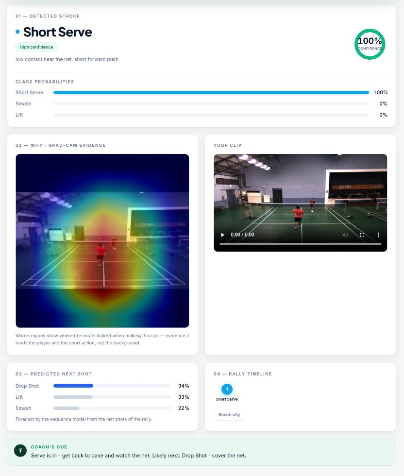
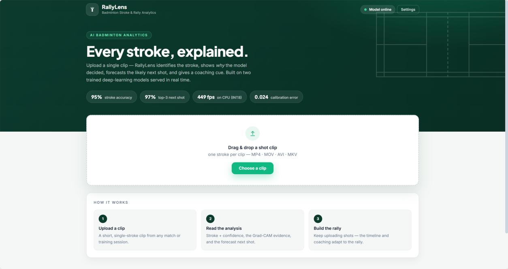
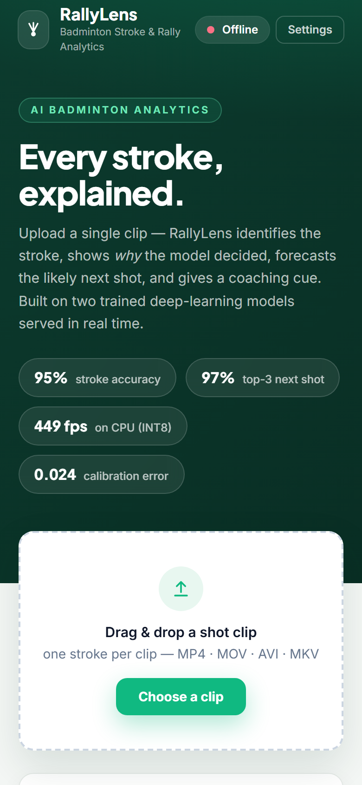
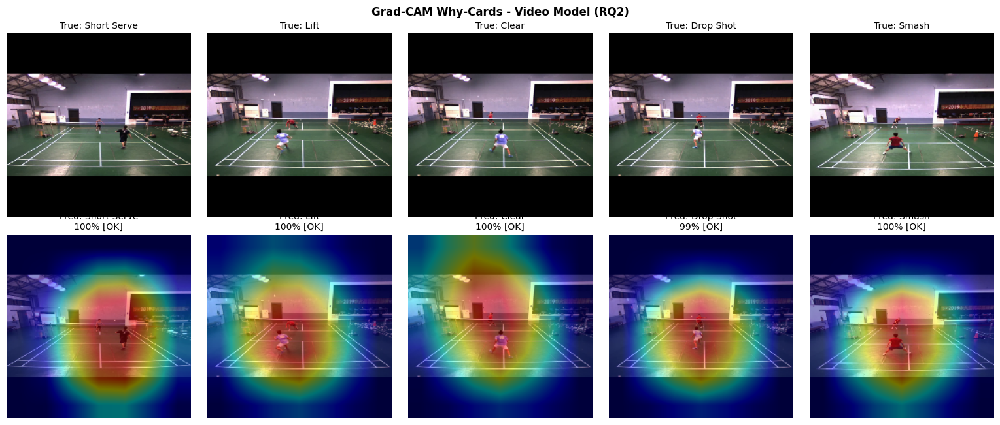
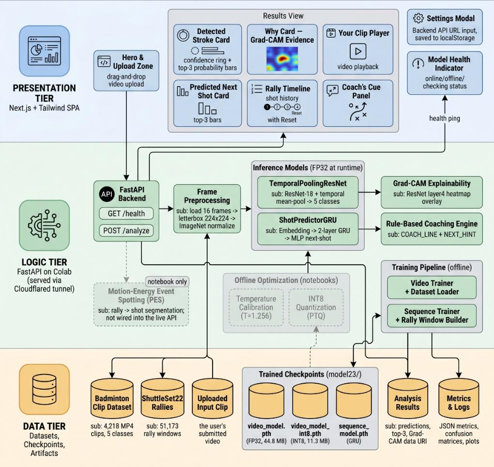
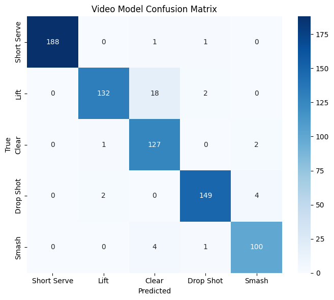
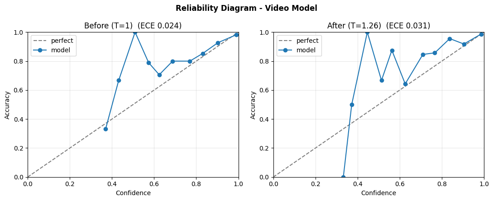
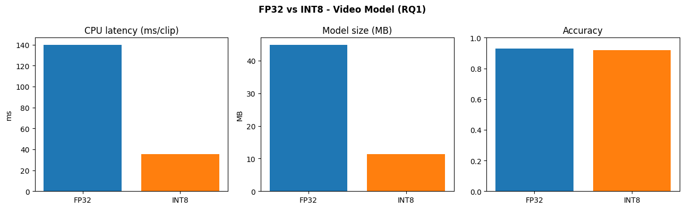
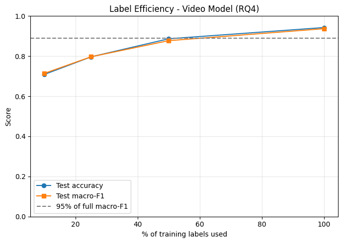

<div align="center">

# RallyLens

**Explainable badminton stroke analytics from a single camera**

Upload a short clip and RallyLens names the stroke, shows *why* it decided with a Grad-CAM heatmap,
flags low-confidence calls for review, predicts the opponent's likely next shot and gives a coaching cue.




</div>

My final-year Computer Science project, built end to end: the research question, data pipeline, two deep-learning models, evaluation, a REST API and a web dashboard.

## Results at a glance

| Result | What it means |
|---|---|
| **95.1%** stroke accuracy | 0.947 macro-F1 on 732 test clips from 8 recording sessions the model never saw in training |
| **97.1%** top-3 next shot | The real next shot is among the model's three picks (8,563 test sequences from ShuttleSet22) |
| **3.9× faster on CPU** | INT8 quantization: 139.7 → 35.6 ms per clip and 44.8 → 11.3 MB, for a 1-point accuracy drop (0.930 → 0.920) |
| **0.024** calibration error | Reported confidence already matches real accuracy (ECE), so the 0.60 "check this" flag is meaningful |
| **50% of labels → 94%** of full performance | Retrained on 10/25/50/100% of the training labels: macro-F1 0.714 / 0.797 / 0.877 / 0.937 |
| **4.8 / 5** in expert review | Stroke identification, rated by six coaches, analysts and players after a live demo |

## The problem

Club and academy coaches film matches with one camera and review them on a laptop. Existing analytics tools tend to need multi-camera rigs or wearable sensors, are too heavy to run in real time on ordinary hardware, or give an answer without saying how sure they are or why. A coach can't act on a call they can't trust.

## How I approached it

1. **Start from the user's constraints.** One camera, a laptop, and a need to know when the output can be trusted.
2. **Turn them into measurable targets.** Accuracy on unseen sessions, latency on a CPU, calibration error, visual explanations, and how many labelled clips the approach needs.
3. **Choose the simplest model that could hit each target, then test it.**
   - an ImageNet-pretrained ResNet-18 with temporal pooling instead of heavy 3D CNNs;
   - a small GRU for four-shot rally histories;
   - post-training quantization before quantization-aware training (which turned out to be unnecessary).
4. **Evaluate it like it matters.** Whole recording sessions held out of training, per-class metrics and baselines, calibration and per-session checks, a label-efficiency study, over/underfitting diagnostics, and feedback from coaches.
5. **Ship something a coach can use.** A FastAPI service and a Next.js dashboard that show the prediction, its confidence, the evidence and a next step.

## What it does

- **Stroke recognition.** Classifies a single-stroke clip as Short Serve, Lift, Clear, Drop Shot or Smash, with a confidence score and top-3 probabilities.
- **Visual explanation.** A Grad-CAM heatmap on the most decisive frame shows where the model looked.
- **Uncertainty flag.** Any prediction below 0.60 confidence is marked for human review.
- **Next-shot forecast.** A sequence model reads the last four shots of the rally and returns the three most likely next shots.
- **Coaching cue.** A short rule-based tip for the current shot and what to prepare for next.
- **Rally timeline.** Upload clips in order to build up a rally; reset to start a new one.
- **Rally analyzer (notebook).** Finds the hits in a full rally video with motion-energy event spotting, classifies each one and reports shot mix and tempo.

## Screenshots

<table>
  <tr>
    <td width="68%"></td>
    <td></td>
  </tr>
  <tr>
    <td><em>Home screen with the model online</em></td>
    <td><em>Responsive layout (captured without a backend, hence "Offline")</em></td>
  </tr>
</table>



*Grad-CAM why-cards: one held-out test clip per stroke class, with the frame the model found most decisive and its heatmap.*

## How it works



What happens when a coach uploads a clip:

1. The dashboard sends the clip and the rally so far (a list of shot ids) to `POST /analyze`.
2. The API samples 16 frames, letterboxes them to 224×224 and normalises them.
3. The stroke classifier returns the label, its confidence and the top-3 classes.
4. Grad-CAM back-propagates the predicted class to ResNet `layer4` and draws a heatmap on the most decisive frame, returned inline as a PNG data URI.
5. The GRU reads the last four shots (left-padded at the start of a rally) and returns the top-3 next shots; rule tables turn the current and predicted shots into a coaching cue.
6. The browser renders the cards and keeps the updated rally history. The API itself is stateless.

Models are trained in Google Colab notebooks and stored on Google Drive. The API runs in a Colab GPU session and is exposed through a free Cloudflare quick tunnel. Details are in [docs/ARCHITECTURE.md](docs/ARCHITECTURE.md).

## The models

| | Stroke classifier | Next-shot model |
|---|---|---|
| **Architecture** | ResNet-18 (ImageNet) applied to each of 16 frames → mean over time → linear layer, ~11.2M parameters | Shot embedding → 2-layer GRU (128 units) → MLP, 178,629 parameters |
| **Data** | 4,218 single-stroke clips, 5 classes, 51 recording sessions; split 2,828 / 658 / 732 by session | ShuttleSet22: 4,743 rallies → 51,173 shot windows (19 stroke labels mapped to 5 classes); split by match |
| **Training** | Weighted cross-entropy, Adam (lr 1e-4), batch 8, best checkpoint by validation macro-F1 | Weighted cross-entropy, Adam (lr 1e-3), 20 epochs, best checkpoint by validation macro-F1 |
| **Test result** | 95.1% accuracy, 0.947 macro-F1 | 53.5% top-1 (majority baseline 43.9%), 97.1% top-3, 0.567 macro-F1 |

## Results

<table>
  <tr>
    <td></td>
    <td></td>
  </tr>
  <tr>
    <td><em>Stroke classifier on 732 held-out clips: 696 correct. The main confusion is Lift vs Clear.</em></td>
    <td><em>Calibration: ECE 0.024 out of the box. Temperature scaling made it slightly worse (0.031), so I kept the raw probabilities.</em></td>
  </tr>
  <tr>
    <td></td>
    <td></td>
  </tr>
  <tr>
    <td><em>INT8 post-training quantization: 3.9× faster on CPU and 4× smaller for one point of accuracy.</em></td>
    <td><em>Label efficiency: half the labels give 94% of full macro-F1.</em></td>
  </tr>
</table>

Across the 8 held-out sessions, accuracy ranged from 88.3% to 98.7% (mean 95.0%). Full tables, learning curves, baselines and tuning results are in [docs/RESULTS.md](docs/RESULTS.md).

## Skills demonstrated

| Area | What I did | Where to look |
|---|---|---|
| Problem framing | Turned coaches' constraints (one camera, a laptop, trust) into measurable goals and an evaluation plan | This page |
| Computer vision | Frame sampling, aspect-preserving letterboxing, motion-energy event spotting with SciPy peak detection | `notebooks/01`, `notebooks/09`, `backend/api.py` |
| Deep learning (PyTorch) | Transfer learning with temporal pooling; a GRU sequence model with padding-aware embeddings; class-weighted losses | `notebooks/01`, `notebooks/02`, `src/` |
| ML evaluation | Session-grouped splits with a leakage check, baselines, ablations, label efficiency, over/underfitting diagnostics, validation-only tuning | `notebooks/05`–`13` |
| Model optimisation | INT8 post-training static quantization with PyTorch FX, CPU latency benchmarking | `notebooks/06` |
| Trustworthy AI | Grad-CAM explanations, calibration (ECE, temperature scaling), risk–coverage analysis, a human-review threshold | `notebooks/05`, `notebooks/07`, `backend/api.py` |
| Backend | FastAPI REST service: multipart uploads, stateless rally history, health checks, graceful fallback when a model is missing | `backend/` |
| Frontend | Next.js 14 + TypeScript + Tailwind dashboard: drag-and-drop upload, SVG confidence ring, rally timeline, responsive layout | `frontend/` |
| Cloud workflow | GPU training and serving on Google Colab, artefacts on Google Drive, public HTTPS through a Cloudflare quick tunnel | `backend/api.ipynb`, `notebooks/` |
| User research | Ran a six-person review with coaches, analysts and players; their criticisms matched the known limitations below | [docs/RESULTS.md](docs/RESULTS.md#expert-review) |

## Engineering decisions

- **No data leakage.** Clips from one recording session share the venue, lighting and players, so splits are made per session and checked with an assertion. Test sessions never appear in training.
- **Imbalanced targets.** Drop Shot is 46% of next-shot targets, so both models use inverse-frequency class weights, select checkpoints on macro-F1, and the next-shot task reports top-3.
- **The serve can be predicted.** The first version could never predict a serve. Left-padding short histories with a dedicated PAD token turned every shot, including the serve, into a training example: 51,173 windows instead of 46,430.
- **Stateless API.** The browser keeps the rally history and sends it with each clip, so the API needs no database or sessions and nothing is lost when the Colab backend restarts.
- **One request, full answer.** The heatmap returns inside the JSON response as a data URI, so the server stores nothing.
- **Measure before adding complexity.** Temperature scaling was tested and rejected. Post-training quantization met the accuracy budget, so quantization-aware training wasn't needed.
- **Coaching text can't hallucinate.** Tips come from rule tables keyed on the model outputs, not from a generative model.

## Repository structure

```
RallyLens/
├── backend/            FastAPI inference service (api.py) and its Colab launcher notebook
├── frontend/           Next.js 14 + TypeScript + Tailwind dashboard
├── notebooks/          13 Colab notebooks: training, evaluation, explainability, diagnostics
├── src/                Script versions of training and inference, plus a Streamlit demo
├── docs/               Architecture notes, full results and all figures
├── config.py           Shared settings for src/ (mirrors the notebooks)
└── requirements.txt    Python dependencies for src/
```

See [notebooks/README.md](notebooks/README.md) for what each notebook does.

## Run it yourself

**1. Backend (Google Colab, GPU)**
1. Put the trained checkpoints `video_model.pth` and `sequence_model.pth` in Google Drive (default folder `MyDrive/BadmintonFYP/model23`). Notebooks 01 and 02 produce them.
2. Open [`backend/api.ipynb`](backend/api.ipynb) in Colab with a GPU runtime and run the cells.
3. Copy the printed `https://….trycloudflare.com` URL.

**2. Frontend**
```bash
cd frontend
npm install
npm run dev        # http://localhost:3000
```
Open **Settings**, paste the backend URL and click **Save & connect**. You can also set `NEXT_PUBLIC_API_URL` in `frontend/.env.local`.

**3. Training data.** ShuttleSet22 downloads automatically. The trimmed stroke-clip dataset and the trained weights (~45 MB) aren't included in this repository; the notebooks read them from Google Drive.

## Limitations and next steps

- **Domain shift.** The classifier learns appearance as well as movement: on professional broadcast footage from a different venue, it labelled every detected shot "Clear". Next: pose/skeleton-based inputs and cross-venue fine-tuning.
- **Scope.** Five stroke classes, singles only. Net kills, drives and doubles aren't covered yet.
- **Next-shot top-1 is modest (53.5%).** Players choose between several reasonable options, so the app shows the top three rather than one answer.
- **Coaching cues are generic.** They scored 2.3/5 in the expert review; experienced coaches wanted advice tied to shuttle placement and the opponent's habits.
- **Demo hosting.** The API runs in a Colab GPU session behind a temporary tunnel and serves the FP32 model. The INT8 model is benchmarked but not yet wired into the API, and the rally analyzer is notebook-only.

## Data and credits

- **ShuttleSet22** stroke-level rally data from the CoachAI project ([GitHub](https://github.com/wywyWang/CoachAI-Projects)); Wang et al., 2023, *ShuttleSet: A Human-Annotated Stroke-Level Singles Dataset for Badminton Tactical Analysis* ([arXiv:2306.04948](https://arxiv.org/abs/2306.04948)).
- **Trimmed single-stroke clip dataset** (4,218 clips), used for research and not redistributed here.
- **ImageNet-pretrained ResNet-18** weights from torchvision.

---

Built by [Mohrimz](https://github.com/Mohrimz) as a final-year Computer Science project.
