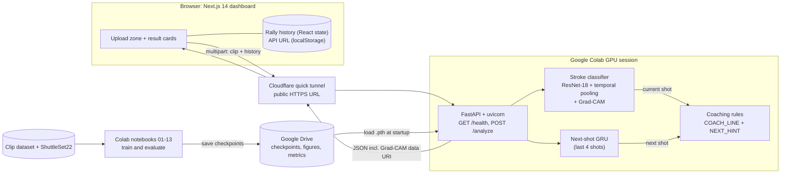
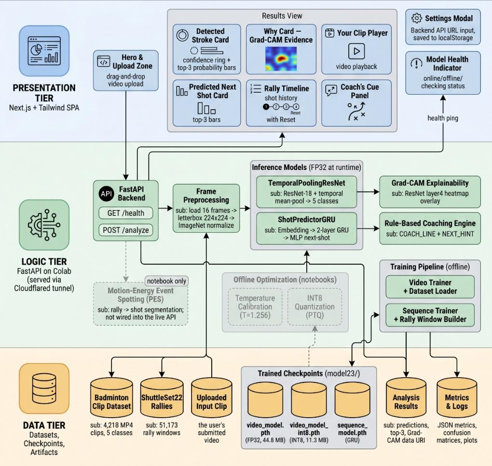
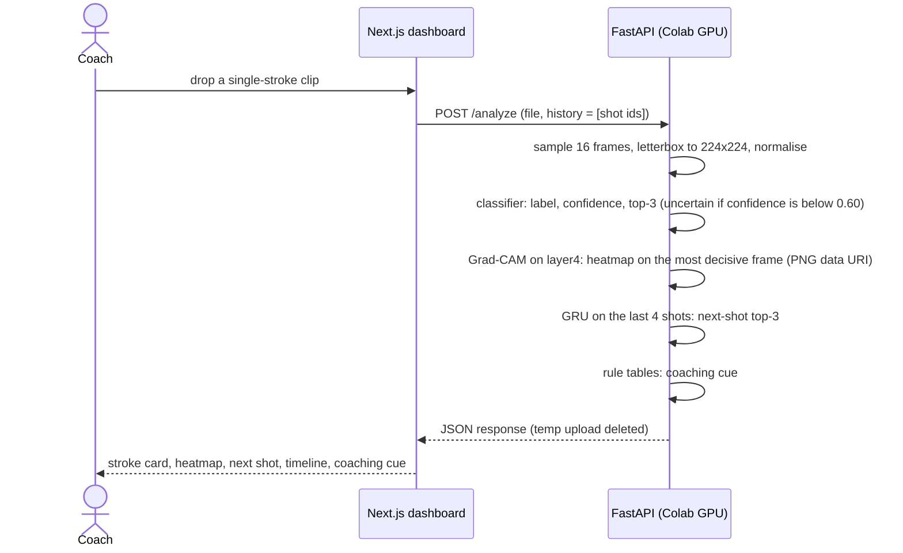
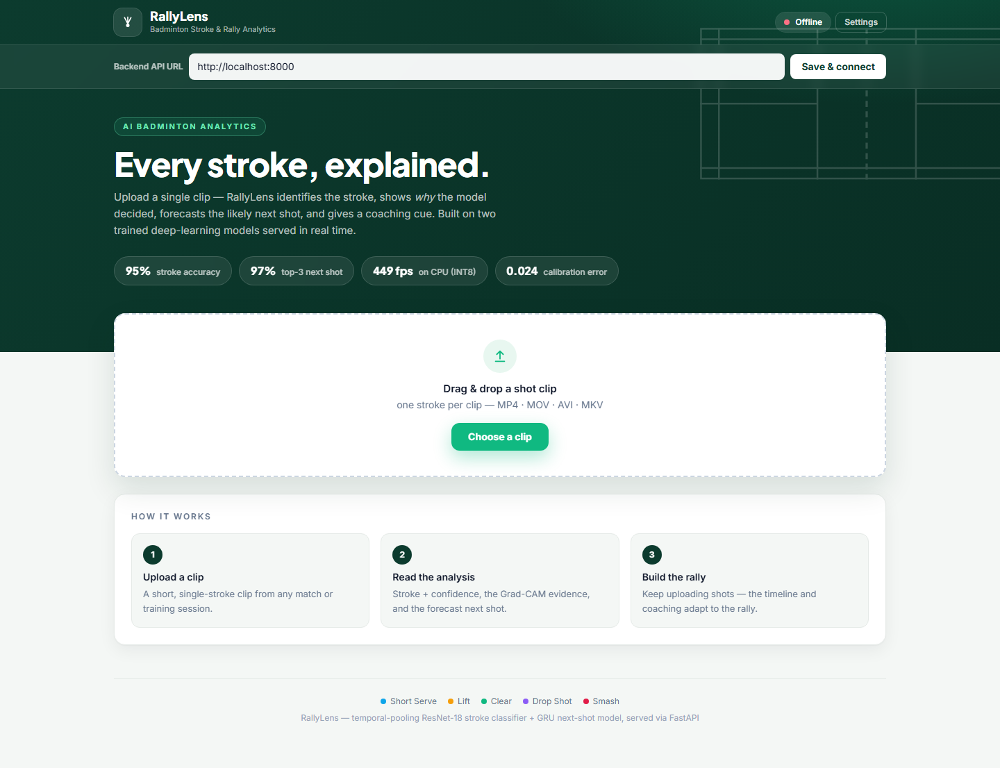

# Architecture

RallyLens has three parts:
- a **Next.js dashboard** that runs in the browser;
- a **FastAPI inference service** that runs in a Google Colab GPU session;
- **Colab notebooks** that train and evaluate the models and store the checkpoints on Google Drive.





## Request lifecycle



## API

| Method | Path | Purpose |
|---|---|---|
| `GET` | `/health` | Service status: device, whether each model loaded, class names. The dashboard's status pill uses it. |
| `POST` | `/analyze` | Multipart form: `file` (video clip, required) and `history` (JSON list of earlier shot ids, default `[]`). Returns the analysis below. |
| `GET` | `/docs` | Interactive Swagger UI generated by FastAPI. |

Example `/analyze` response. Values are rounded and taken from the run shown in the screenshot; the image string is shortened.

```json
{
  "current": {
    "label": "Short Serve",
    "confidence": 1.0,
    "uncertain": false,
    "why": "low contact near the net, short forward push",
    "top3": [
      {"label": "Short Serve", "prob": 1.0},
      {"label": "Smash", "prob": 0.0},
      {"label": "Lift", "prob": 0.0}
    ]
  },
  "gradcam": "data:image/png;base64,iVBORw0KGgo...",
  "next": [
    {"label": "Drop Shot", "prob": 0.34},
    {"label": "Lift", "prob": 0.33},
    {"label": "Smash", "prob": 0.22}
  ],
  "coaching": "Serve is in - get back to base and watch the net. Likely next: Drop Shot - cover the net.",
  "history": ["Short Serve"],
  "history_ids": [0]
}
```

**Failure behaviour**
- If the stroke model can't be loaded, `/analyze` returns `{"error": "..."}` and the dashboard shows the message.
- If only the sequence model is missing, `next` is `null` and the coaching cue drops the "Likely next" part.

## Design decisions

- **Stateless API, history kept in the browser.** The dashboard stores the rally as a list of shot ids and sends it with every clip; the server uses the last four. There is no database or session store, and restarting the Colab backend or changing its URL loses nothing.
- **Explanation in the same response.** The Grad-CAM overlay is encoded as a PNG data URI inside the JSON, so one request returns everything and the server persists nothing. The uploaded clip goes to a temp file that is deleted after inference.
- **Same preprocessing in training and serving.** The service samples 16 frames uniformly, letterboxes them to 224×224 keeping the aspect ratio, and applies ImageNet normalisation: the same steps as the training notebooks.
- **Coaching text from rules, not a language model.** Tips are looked up from tables keyed on the current and predicted shots, so they are deterministic and can't invent facts.
- **Confidence threshold.** Predictions below 0.60 are flagged for review. The calibration study showed this cut-off keeps about 94% of clips at 96% accuracy (see [RESULTS.md](RESULTS.md#calibration-and-uncertainty)).
- **Hosting on Colab plus a Cloudflare tunnel.** Colab provides the GPU but no public IP, so the launcher notebook starts uvicorn and opens a free Cloudflare quick tunnel. Because the tunnel URL changes every session, the dashboard lets you change the backend URL at runtime and remembers it.



## Configuration

| Variable | Where | Default |
|---|---|---|
| `MODEL_DIR` | backend, `config.py` | `/content/drive/MyDrive/BadmintonFYP/model23` |
| `PORT` | backend (`python api.py`) | `8000` |
| `NEXT_PUBLIC_API_URL` | frontend (`.env.local`) | `http://localhost:8000` (can be overridden in Settings) |

## Training and serving pipeline

1. **Train.** `notebooks/01` trains the stroke classifier and `notebooks/02` trains the next-shot GRU. Both save checkpoints, metrics and confusion matrices to Google Drive.
2. **Evaluate.** `notebooks/05`–`08` and `10`–`13` evaluate calibration, quantization, explanations, label efficiency, fit and hyperparameters. They write separate files and never overwrite the deployed checkpoints.
3. **Serve.** `backend/api.ipynb` mounts Drive, starts the API and opens the tunnel. The dashboard connects to the printed URL.
