# Results

Every number on this page is printed by a notebook in [`notebooks/`](../notebooks); the figures are the notebooks' own outputs. Test sets were touched once per trained model, and all splits keep whole recording sessions (clips) or whole matches (ShuttleSet22) on one side.

- [Stroke classifier](#stroke-classifier)
- [Next-shot model](#next-shot-model)
- [Calibration and uncertainty](#calibration-and-uncertainty)
- [Accuracy per held-out session](#accuracy-per-held-out-session)
- [INT8 quantization](#int8-quantization)
- [Explainability](#explainability)
- [Label efficiency](#label-efficiency)
- [Hyperparameter tuning](#hyperparameter-tuning)
- [Rally analyzer](#rally-analyzer)
- [Expert review](#expert-review)

---

## Stroke classifier

ResNet-18 temporal-pooling model, tested on **732 clips from 8 held-out recording sessions** (`notebooks/01_train_video.ipynb`).

**Accuracy 0.951 · macro-F1 0.947**

| Class | Precision | Recall | F1 | Test clips |
|---|---|---|---|---|
| Short Serve | 1.00 | 0.99 | 0.99 | 190 |
| Lift | 0.98 | 0.87 | 0.92 | 152 |
| Clear | 0.85 | 0.98 | 0.91 | 130 |
| Drop Shot | 0.97 | 0.96 | 0.97 | 155 |
| Smash | 0.94 | 0.95 | 0.95 | 105 |

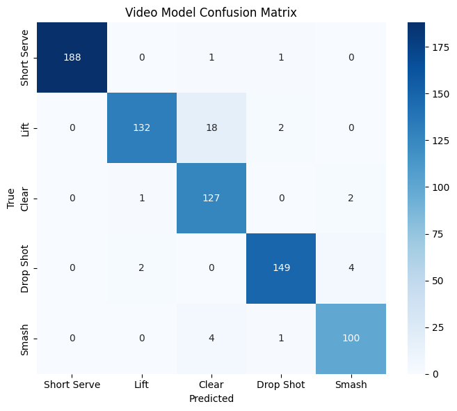

Lift is the hardest class to recall: 18 of its 20 errors are predicted as Clear. A lift and a clear both send the shuttle high and deep, and 16 frames of player appearance only partly capture the trajectory.

**Overfitting check** (`notebooks/10_overfitting_check.ipynb`). Macro-F1 is 0.989 on train, 0.923 on validation and 0.947 on test. The train–test gap of 0.041 is inside the notebook's "healthy" band.

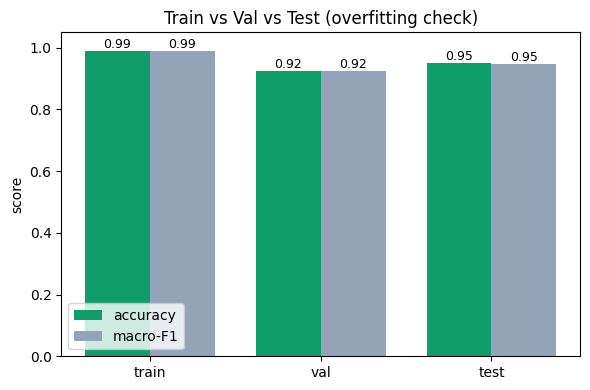

**Baselines** (`notebooks/12_underfitting_check.ipynb`). Always predicting the most common class scores 0.178, and random guessing scores 0.200, against the model's 0.951.

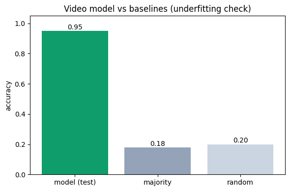

**Learning curves** (`notebooks/11_learning_curves.ipynb`, a separate re-training run for visualisation). Validation macro-F1 peaks at epoch 2 (0.886) and early stopping ends the run at epoch 6, while training loss keeps falling.

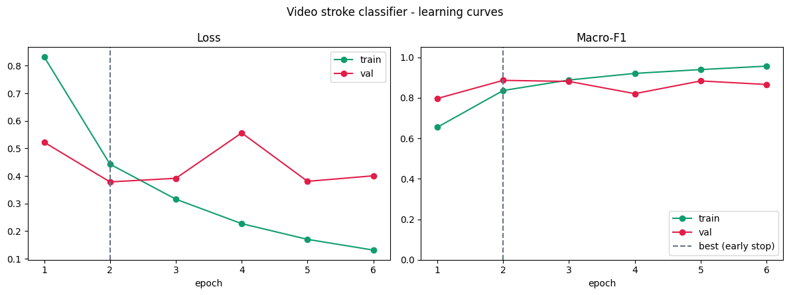

---

## Next-shot model

GRU over the last four shots, tested on **8,563 windows from held-out ShuttleSet22 matches** (`notebooks/02_train_sequence.ipynb`).

**Top-1 0.535 · macro-F1 0.567 · top-3 0.971** (178,629 parameters)

| Next shot | Precision | Recall | F1 | Test windows |
|---|---|---|---|---|
| Short Serve | 0.87 | 1.00 | 0.93 | 681 |
| Lift | 0.45 | 0.67 | 0.54 | 1,716 |
| Clear | 0.41 | 0.34 | 0.37 | 1,253 |
| Drop Shot | 0.69 | 0.44 | 0.53 | 3,763 |
| Smash | 0.38 | 0.59 | 0.46 | 1,150 |

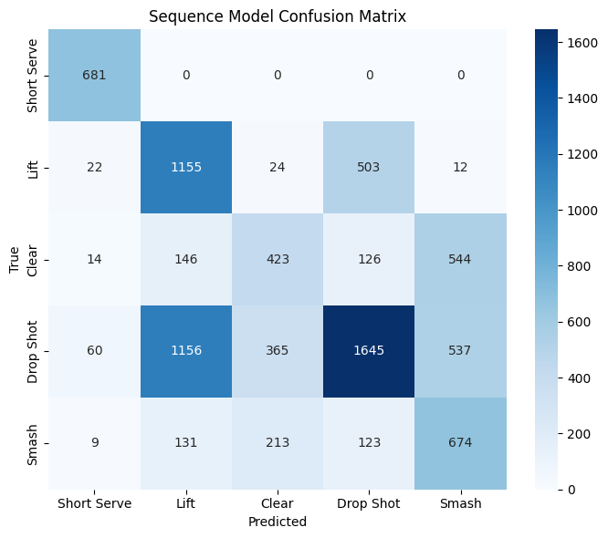

Predicting a player's next choice is inherently uncertain, so top-3 is the useful number: the real next shot is in the model's three picks 97.1% of the time. Serves are fully predictable (recall 1.00), because windowing pads the start of every rally so the serve becomes a learnable target.

**Baselines and fit** (`notebooks/12_underfitting_check.ipynb`). The majority class (Drop Shot) scores 0.439 top-1 and random guessing 0.200. Train and test scores are close (macro-F1 0.554 vs 0.567), so the ceiling comes from the task rather than from overfitting.

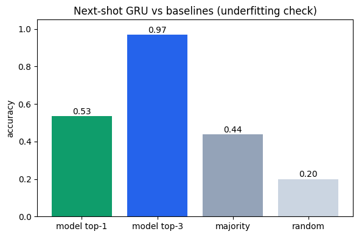

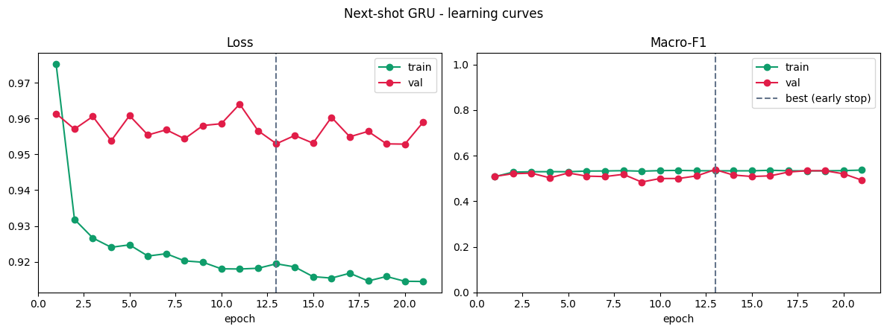

---

## Calibration and uncertainty

`notebooks/05_calibration_robustness.ipynb`

| | Value |
|---|---|
| Expected calibration error (15 bins, test set) | **0.0239** |
| Temperature fitted on the validation set (LBFGS) | T = 1.256 |
| ECE after temperature scaling | 0.0311 (worse) |
| Decision | Keep the raw softmax probabilities |

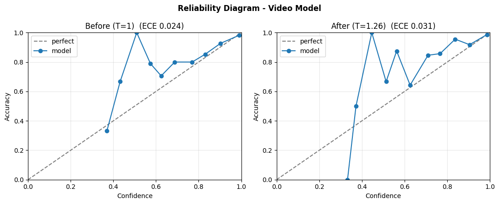

**Selective prediction.** Ranking clips by confidence shows that errors concentrate in the low-confidence tail. The table below comes from the calibration study, which used the temperature-scaled confidences.

| Confidence threshold | Clips handled automatically | Accuracy on those clips | Flagged for review |
|---|---|---|---|
| 0.50 | 98.5% | 0.954 | 1.5% |
| **0.60** (used in the app) | **94.1%** | **0.962** | **5.9%** |
| 0.70 | 91.8% | 0.969 | 8.2% |
| 0.80 | 85.7% | 0.978 | 14.3% |
| 0.90 | 76.1% | 0.984 | 23.9% |

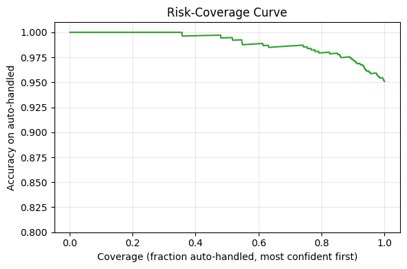

---

## Accuracy per held-out session

Accuracy on each of the 8 test sessions, to make sure no single venue or camera fails (`notebooks/05_calibration_robustness.ipynb`).

| Session | S1 | S2 | S3 | S4 | S5 | S6 | S7 | S8 |
|---|---|---|---|---|---|---|---|---|
| Clips | 77 | 67 | 83 | 139 | 56 | 169 | 66 | 75 |
| Accuracy | 0.883 | 0.925 | 0.928 | 0.928 | 0.982 | 0.982 | 0.985 | 0.987 |

Mean 0.950 · min 0.883 · max 0.987 · standard deviation 0.039.

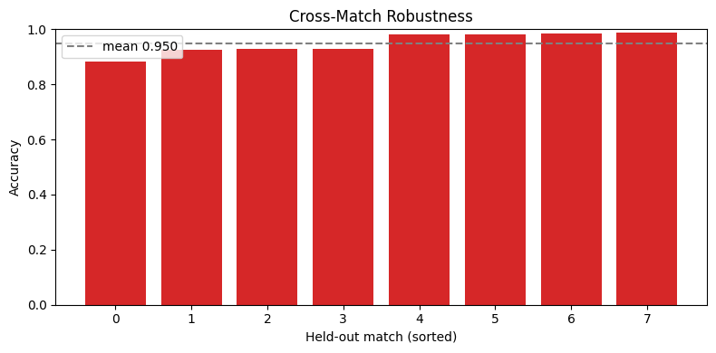

---

## INT8 quantization

`notebooks/06_quantization_latency.ipynb`

The ResNet-18 trunk is converted to INT8 with PyTorch FX post-training static quantization (`x86` backend). Activation ranges are calibrated on 8 real clips (128 frames); the temporal mean and classification head stay in FP32.

| | FP32 | INT8 |
|---|---|---|
| Accuracy (200-clip test subset) | 0.930 | 0.920 |
| Macro-F1 (200-clip test subset) | 0.924 | 0.917 |
| Model size | 44.8 MB | 11.3 MB |
| CPU latency per 16-frame clip | 139.7 ms | 35.6 ms |
| Throughput | 115 frames/s | 449 frames/s |

**3.92× faster and 3.96× smaller for a 0.01 accuracy drop.**

Protocol: forward pass on a pre-built clip tensor, batch size 1, 5 warm-up runs then 30 timed runs, 6 CPU threads on a Colab VM. Video decoding and preprocessing are not included in the timings.

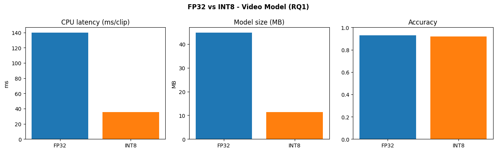

---

## Explainability

`notebooks/07_xai_explainability.ipynb`

How the heatmap is made:
1. Hooks on ResNet `layer4` capture each frame's activations and the gradients of the predicted class.
2. The gradients are averaged into channel weights, which give a 7×7 map per frame.
3. The frame whose map has the largest total value is upsampled to 224×224 and overlaid on that frame.

The web API runs the same code on every request.

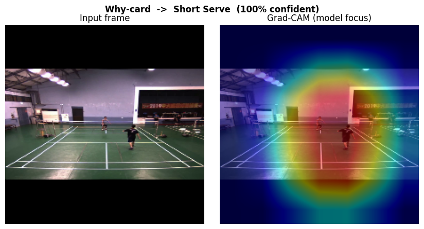

A grid with one held-out clip per class is on the [main page](../README.md#screenshots).

---

## Label efficiency

`notebooks/08_label_efficiency.ipynb`

A fresh model is trained on class-stratified fractions of the training set, and each is scored on the same 732-clip test set.

| Labels used | Training clips | Test accuracy | Macro-F1 | Share of full macro-F1 |
|---|---|---|---|---|
| 10% | 282 | 0.709 | 0.714 | 76% |
| 25% | 707 | 0.796 | 0.797 | 85% |
| 50% | 1,414 | 0.887 | 0.877 | 94% |
| 100% | 2,828 | 0.943 | 0.937 | 100% |

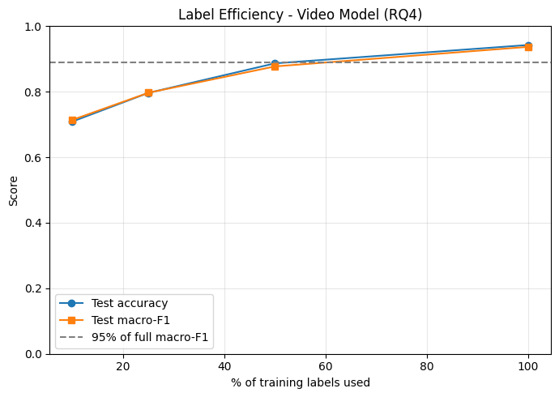

Each run in this sweep trains for at most 8 epochs, with early stopping (patience 3) on validation macro-F1. That's why the 100% run (0.943) sits slightly below the main model (0.951).

---

## Hyperparameter tuning

`notebooks/13_hyperparameter_tuning.ipynb`. All selection is on the validation set.

**GRU grid (validation macro-F1, 2 layers, dropout 0.3)**

| Learning rate | hidden 64 | hidden 128 | hidden 256 |
|---|---|---|---|
| 5e-4 | 0.509 | 0.524 | 0.530 |
| 1e-3 | 0.525 | 0.535 | 0.537 |
| 2e-3 | 0.522 | **0.541** | 0.531 |

Then a dropout sweep at lr 2e-3 / hidden 128: 0.2 → 0.542, 0.3 → 0.541, 0.5 → 0.534.

The tuned model (lr 2e-3, hidden 128, dropout 0.2) scored 0.548 top-1, 0.574 macro-F1 and 0.971 top-3 on test. That's a small gain (+0.0074 validation macro-F1 over the defaults), so the app keeps the original model.

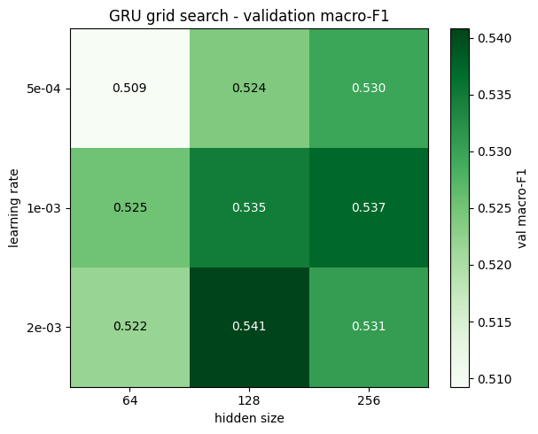

**Video learning-rate sweep** (30% training subset, 4 epochs, best validation macro-F1)

| Learning rate | 3e-4 | 1e-4 | 3e-5 |
|---|---|---|---|
| Validation macro-F1 | 0.784 | **0.810** | 0.759 |

The best value, 1e-4, is the one the deployed classifier uses.

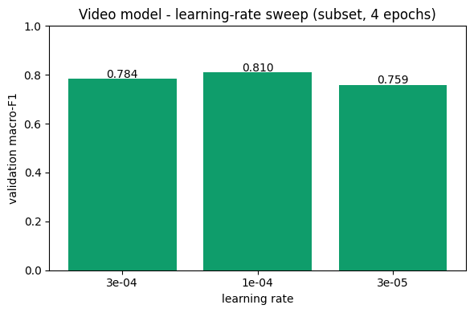

---

## Rally analyzer

`notebooks/09_rally_pes.ipynb` turns a full rally video into individual shots without a shuttle tracker:

1. Downscale frames to at most 320 px and compute a motion-energy signal (mean absolute grayscale frame difference).
2. Smooth it with a 5-frame moving average.
3. Detect hits with SciPy `find_peaks`. Prominence is set relative to each clip (0.45 × (95th − 50th percentile)), and hits must be at least 0.5 s apart.
4. Take a ±0.6 s window around each hit, sample 16 frames, and classify it with the stroke model.
5. Report a timeline, shot mix, tempo (seconds per shot), the next-shot forecast and a coaching line.

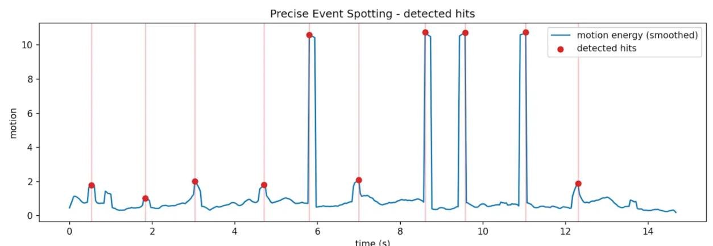

*Motion-energy signal for one rally clip, with detected hits in red.*

---

## Expert review

The app was demonstrated live to six people:
- 2 certified badminton coaches;
- 2 sports-analytics or ML professionals;
- 1 competitive player;
- 1 recreational player.

Five of the six had 5+ years in the sport. Each then rated five statements from 1 to 5 in an anonymous questionnaire.

| Statement | Mean (out of 5) |
|---|---|
| The stroke the system identified matched the actual shot | **4.8** |
| The Grad-CAM "why" highlight made the decision believable | **4.5** |
| The confidence score and "uncertain" flag felt trustworthy | **4.0** |
| The predicted next shot(s) were tactically reasonable | 3.2 |
| The coaching cue was meaningful and tactically sound | 2.3 |

**What they valued:** honest confidence and flagging of shaky calls, speed on a normal CPU, and labels reliable enough to build shot-mix statistics.

**What they asked for:**
- testing on footage from outside the training set;
- doubles and more stroke types;
- coaching tied to shuttle placement and the opponent;
- a short reason for each next-shot prediction;
- confidence intervals on the headline numbers.

These criticisms match the limitations listed on the [main page](../README.md#limitations-and-next-steps).
